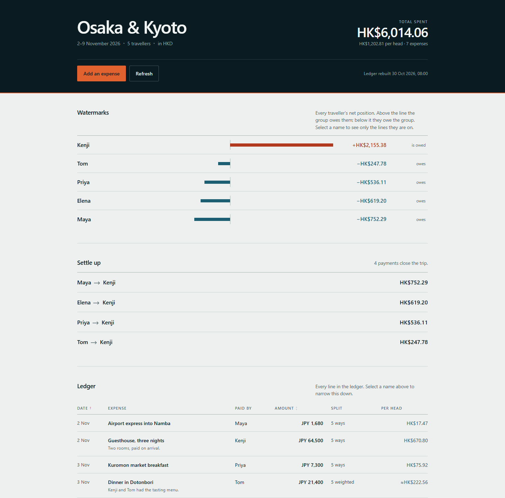

# Trip ledger

A shared bill splitter for one trip, with no server, no database, and no account
beyond the GitHub one you already have.

You add a spending as a GitHub **issue**. A workflow turns every open issue into
`data/expenses.json`. A static page reads that file and works out who owes whom.
GitHub Pages hosts the page.

```
github issue (a form)  ->  Actions rebuilds JSON  ->  commits it  ->  Pages serves index.html
                                                                        |
                                                          the page does the split maths
```

The page never talks to GitHub's API and holds no token. It reads two static
files, so there is nothing to leak and nothing to keep running.



*The page with its demo rows. Vermilion and teal bars sit on a shared centre
line — right means the group owes you, left means you owe the group.*

## What you get

- Any currency, converted through rates you control in `config.json`.
- Three ways to split a line: evenly, by weighted shares, or by exact amounts.
- Per-person net position, and the shortest list of payments that settles it.
- Malformed issues are listed on the page instead of being silently dropped.

## Set it up

1. **Create a public repository** and push this folder to it. (Public is required
   for Pages on the free plan. See *Before you make it public* below.)
2. **Create a label called `expense`** — Issues → Labels → New label. Every issue
   that counts must carry it; the issue form adds it automatically.
3. **Turn on Pages**: Settings → Pages → Build and deployment → Source →
   **GitHub Actions**. Not "Deploy from a branch".
4. **Fill in `config.json`**: your trip name, dates, the traveller list, the
   currency you want to settle in, and `repository` as `owner/name`.
5. **Edit the two traveller lists in `.github/ISSUE_TEMPLATE/expense.yml`** so the
   form's dropdown and checkboxes match `config.json`. This is the one duplication
   in the project; a name that is in one and not the other shows up as a warning
   on the page rather than disappearing.
6. **Run the workflow once**: Actions → *Rebuild ledger* → Run workflow. This
   replaces the demo rows with an empty ledger.

## Day to day

**Add an expense.** Open the site and press *Add an expense*, or go to Issues →
New issue → Expense. Fill the form, submit, wait about a minute.

**Fix one.** Edit the issue. The workflow reruns and the ledger updates.

**Delete one.** Close the issue. Closed issues are not counted, which also makes
closing the clean way to remove a mistake.

## Changing the trip

| What | Where |
| --- | --- |
| Trip name, dates | `config.json` → `trip`, `dates` (no rebuild needed) |
| Who is on the trip | `config.json` → `travellers` **and** the two lists in `.github/ISSUE_TEMPLATE/expense.yml` |
| Currency everything settles in | `config.json` → `baseCurrency` |
| Exchange rates | `config.json` → `ratesToBase`, as *units of your base currency per 1 unit of that currency* |

Rates are manual and deliberately so — a live FX feed would need a server and a
key, and would change historical numbers every day. Update them once mid-trip if
the rate moves enough to matter.

## Three things that will bite you

1. **The data is public.** A free-plan Pages site needs a public repository, so
   everyone's spending — and who owes whom — is world-readable. Fine for most
   friend groups; decide before you start.
2. **Anyone can open an expense.** The form applies the `expense` label, and on a
   public repository anyone can submit one. Review the issue list occasionally;
   close anything that isn't yours.
3. **It is not live.** GitHub Pages caches for about ten minutes, so a new
   expense can take a minute or two to appear. Press *Refresh* to re-fetch
   without a hard reload.

## Troubleshooting

| Symptom | Cause |
| --- | --- |
| Page shows "No expenses yet" | No open issue carries the `expense` label yet |
| An expense is missing but the issue is open | The label is missing, or the workflow failed — check the Actions tab |
| A line appears under "Needs fixing" | Read the reason: the message names the field and what is wrong with it |
| Nothing ever updates | Pages is set to "Deploy from a branch" instead of "GitHub Actions" |
| The workflow fails on `git push` | Branch protection is on for the default branch; allow the workflow to push, or turn protection off |
| Totals ignore an expense | Its currency has no entry in `ratesToBase` |

## Files

```
index.html                      the page
styles.css                      one stylesheet, no framework
app.js                          split maths and rendering
config.json                     trip, travellers, currencies, rates
data/expenses.json              the ledger — generated, do not hand-edit
scripts/build-data.mjs          issues -> JSON
.github/ISSUE_TEMPLATE/expense.yml   the form your friends fill in
.github/workflows/ledger.yml    rebuild + deploy
```

`data/expenses.json` ships with clearly-labelled demo rows so the page is not
empty on first look. The first real expense overwrites them.

## The maths

Amounts are converted to your base currency, then allocated in whole cents with a
largest-remainder pass, so the parts always add back to the total exactly. No
`0.01` disappearing. Balances are `paid − owed` per person, and the settle-up list
matches the largest debtor to the largest creditor repeatedly, which needs at most
one fewer payment than there are people.
